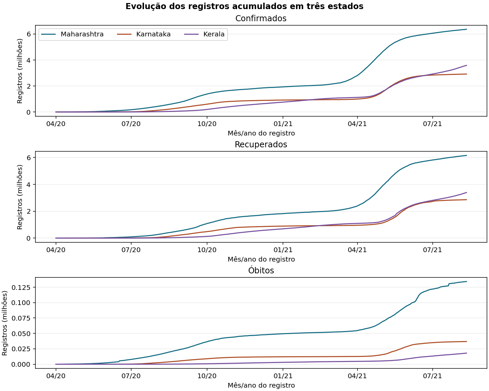
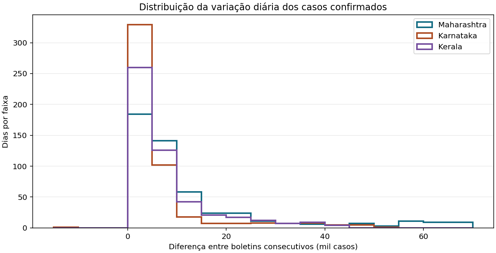
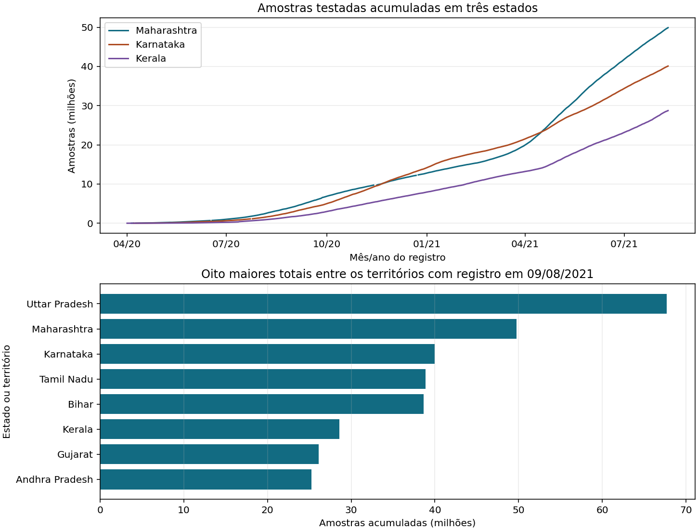
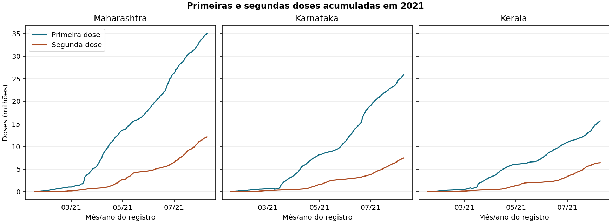
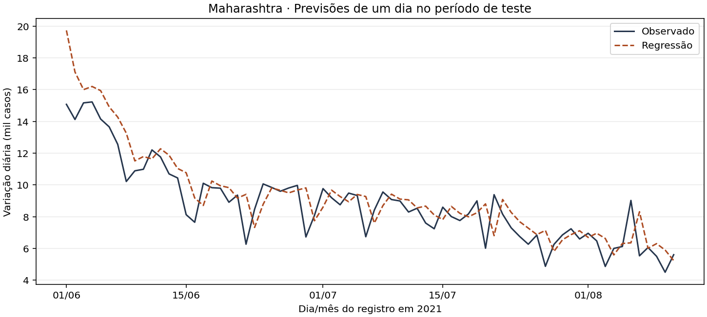

# RA3 · COVID-19 na Índia

O projeto investiga a evolução dos registros de casos, recuperações e óbitos, o volume de testes e a administração das duas primeiras doses. Para comparar as séries, o RA3 usa Maharashtra, Karnataka e Kerala, três estados com cobertura no intervalo comum da análise de casos e com dados nas outras duas bases. Para a comparação de testes em uma data, inclui também os demais territórios com valor disponível.

## 1. Estatística descritiva

Para cada estado, calculamos a variação diária dos casos confirmados como o acumulado do dia menos o acumulado do dia anterior. A série é indexada por dia de calendário, de modo que uma ausência interromperia o cálculo das diferenças que dependem dela. O período de 01/04/2020 a 11/08/2021 contém 498 diferenças válidas por estado.

| Estado | Média | Mediana | Desvio-padrão amostral | Mínimo | Máximo | Amplitude | Dias abaixo de 10 mil |
|---|---:|---:|---:|---:|---:|---:|---:|
| Maharashtra | 12.777,56 | 7.022,50 | 15.752,35 | 0 | 68.631 | 68.631 | 325 (65,3%) |
| Karnataka | 5.865,39 | 1.872,50 | 9.663,01 | −11.931 | 50.112 | 62.043 | 432 (86,7%) |
| Kerala | 7.201,72 | 4.633,00 | 8.904,48 | 0 | 43.529 | 43.529 | 386 (77,5%) |

As médias superam as medianas nos três estados. Os picos elevam a média, e a mediana descreve melhor um dia típico nesse recorte. Maharashtra teve a maior mediana e o maior desvio-padrão. A amplitude de Karnataka inclui a queda de 11.931 em 09/03/2021, mantida como variação do boletim. Uma diferença negativa indica redução no acumulado publicado e pode refletir uma revisão de registros. A origem específica dessa queda permanece incerta.

## 2. Visualizações e interpretação

### 1 · Evolução dos casos, recuperações e óbitos

Os confirmados e recuperados aceleraram entre abril e maio de 2021. Os picos da média móvel de sete dias da variação dos confirmados ocorreram em 25/04 em Maharashtra (65.447 por dia), 10/05 em Karnataka (47.502) e 13/05 em Kerala (38.143). Em 11/08, Kerala tinha 3,59 milhões de confirmados ante 2,92 milhões em Karnataka, enquanto o total registrado de óbitos em Karnataka era maior (36.848 ante 18.004). Maharashtra terminou o recorte com os maiores totais nos três indicadores. Cada painel tem escala própria.

### 2 · Distribuição das variações diárias

Os três estados concentram dias nas faixas baixas, com uma cauda à direita. Karnataka teve 432 dos 498 dias abaixo de 10 mil, embora tenha ultrapassado 50 mil no maior dia. Maharashtra teve menos dias abaixo de 10 mil e alcançou as maiores faixas do histograma.

### 3 · Volume de testes

Os acumulados dos três estados aumentaram ao longo da série, e Maharashtra se distanciou dos outros dois a partir do segundo trimestre de 2021. Entre os 35 territórios com dados em 09/08/2021, Uttar Pradesh liderou em volume absoluto (67,69 milhões de amostras), seguido por Maharashtra (49,73 milhões). Karnataka registrou 39,98 milhões e Kerala, 28,61 milhões. A comparação usa uma data comum para reduzir a influência de diferenças de calendário.

### 4 · Primeira e segunda dose

As duas contagens cresceram nos três estados. Em 09/08/2021, último dia com os dois valores preenchidos em cada um deles, Maharashtra tinha 35,04 milhões de primeiras doses e 12,11 milhões de segundas. Karnataka tinha 25,85 e 7,43 milhões, e Kerala, 15,67 e 6,43 milhões. A diferença entre as curvas mostra o intervalo entre os volumes registrados das duas etapas. A base agregada carece de seguimento individual e de um denominador de população elegível.

### 5 · Previsões de casos para Maharashtra

A regressão acompanhou a queda geral do período, com uma superestimativa mais visível nos primeiros dias de junho. O gráfico usa previsões de um dia à frente e os boletins reais anteriores a cada data-alvo.

## 3. Origem, abrangência e representatividade

Os arquivos foram fornecidos ao projeto como parte do conjunto **COVID-19 in India**, atribuído a Sudalai Rajkumar no Kaggle. A versão do download e a cadeia de fontes primárias não foram confirmadas no RA1. Os CSVs preparados contêm 18.110 registros de casos (30/01/2020 a 11/08/2021), 16.335 de testes (01/04/2020 a 10/08/2021) e 7.845 de vacinação (16/01/2021 a 16/08/2021). Os totais incluem linhas com valores ausentes e, conforme a base, categorias nacionais ou sem território definido.

Os registros permitem descrever os valores publicados no período e nos territórios selecionados. O recorte de três estados foi intencional. Usamos todos os dias elegíveis no intervalo de cada análise, sem amostragem aleatória. As comparações estaduais usam contagens absolutas, influenciadas pelo tamanho da população e pela disponibilidade de testes e vacinas. Infecções sem diagnóstico, atrasos de notificação e revisões podem alterar os acumulados e suas diferenças diárias. Uma pessoa pode gerar mais de uma amostra de teste. Diferenças na cobertura territorial, nas datas e no preenchimento limitam a generalização para toda a Índia ou para períodos posteriores.

## 4. Aprendizagem supervisionada

A regressão estima a variação do acumulado de confirmados em Maharashtra para o próximo boletim diário. Para a data-alvo `t`, as duas características são a variação observada em `t − 1` e a média das sete variações de `t − 7` a `t − 1`. A variável-alvo é a variação observada em `t`, na unidade de casos registrados por dia. O modelo é uma regressão linear com intercepto ajustada por mínimos quadrados com NumPy.

O treino abrangeu 419 datas-alvo, de 08/04/2020 a 31/05/2021. O teste teve 72 datas de 01/06/2021 a 11/08/2021. O corte cronológico reserva os boletins mais recentes para avaliação. O modelo fica fixo após o treino, e cada previsão de teste usa somente observações anteriores à data-alvo. O cenário de uso é uma previsão diária atualizada conforme chegam os boletins. A referência de persistência prevê a mesma variação observada na véspera.

| Modelo | MAE (casos/dia) | RMSE (casos/dia) |
|---|---:|---:|
| Regressão linear | 1.052,14 | 1.429,60 |
| Persistência | 1.070,76 | 1.421,08 |

O MAE mede o erro absoluto médio. A regressão reduziu esse erro em cerca de 19 casos por dia (1,7%). O RMSE dá mais peso aos desvios grandes e foi 8,52 casos por dia maior para a regressão. O ganho sobre a persistência depende da métrica e é pequeno neste intervalo de queda. A avaliação cobre um único estado e período de teste, com variáveis derivadas dos próprios boletins.

## 5. Conclusão

Maharashtra reuniu as maiores variações diárias típicas de confirmados e os maiores volumes de testes e de doses entre os três estados analisados. A mediana e o histograma mostram que os picos de 2021 ficaram longe do comportamento diário mais comum. A comparação na mesma data evidenciou diferenças no volume de testes entre territórios, e as séries de vacinação mostraram que as segundas doses acumulavam em menor volume ao longo do período.

O exercício de previsão mostra que o histórico recente ajuda a acompanhar a trajetória de curto prazo, com melhora pequena no MAE e piora no RMSE frente à persistência. Os resultados descrevem os boletins disponíveis. Subnotificação, cobertura desigual, ausência de denominadores populacionais e o recorte temporal limitam inferências sobre incidência, cobertura vacinal e desempenho futuro do modelo.

## Reprodução

Siga as [instruções no README](../README.md#8-ra3--análise-dos-dados-e-previsão). O [código do RA3](../scripts/ra3.py) gera as figuras acima, imprime as tabelas e exporta [as previsões diárias](../output/ra3/previsoes.csv) com as características, os valores observados e as duas previsões.
